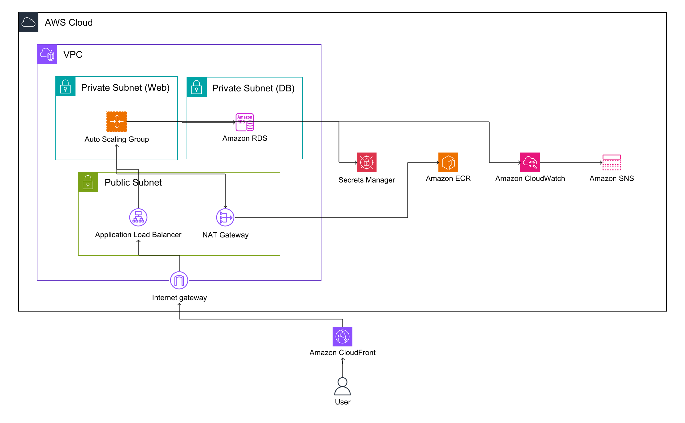
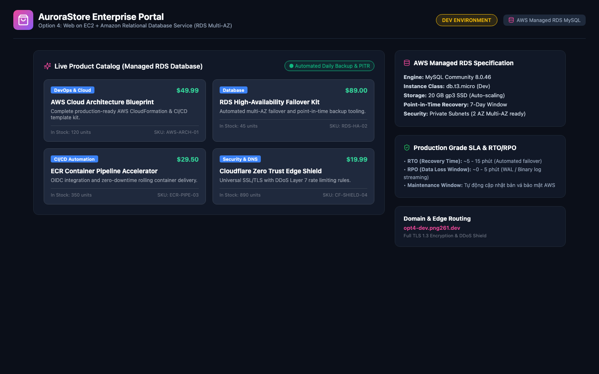
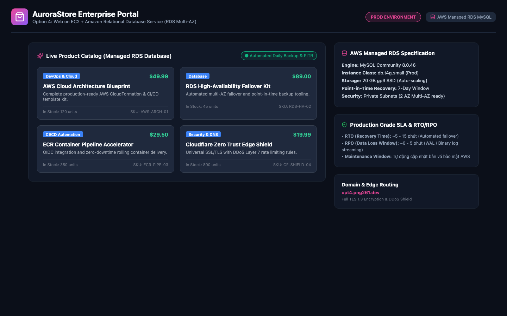

# Option 4: 1 EC2 Web ASG + 1 AWS Managed RDS Database (Recommended)

Independent infrastructure and application source code for **Option 4: 1 EC2 Web ASG + 1 AWS Managed RDS Database (Recommended Architecture)**.

## 1. Architecture Overview

### Key Architectural Highlights:
- **CloudFront CDN Edge Caching:** Caches static assets globally, offloading 80–90% of requests from origin servers, lowering TTFB.
- **Application Load Balancer (ALB):** Spans Multi-AZ Public Subnets, balancing incoming HTTP/HTTPS traffic with health probes on `/api/health`.
- **Web Auto Scaling Group (ASG):** Resides securely within Private Subnets, automatically scaling EC2 instances based on CPU utilization.
- **AWS Managed RDS PostgreSQL (Multi-AZ):** Fully managed relational database located in Private Subnets with automated backups, storage encryption, and automated failover.
- **AWS Secrets Manager Integration:** Zero hardcoded plaintext database passwords; credentials securely rotated and dynamically supplied to compute tiers.
- **AWS-Native Custom Domain:** Directs user traffic via DNS CNAME directly to CloudFront & ALB endpoints.

## 2. Cost Analysis

### A. Cost by Purchasing Option & Optimization (Singapore Region: `ap-southeast-1`)
| Purchasing Model | Web Compute (EC2) | RDS Managed (PostgreSQL) | Storage, IP & Backup | Total Monthly Cost | Approx. Local Currency (VND) |
| :--- | :--- | :--- | :--- | :--- | :--- |
| **On-Demand (Default)** | $15.18 | $23.36 (`db.t4g.small`) | $9.10 | **$47.64 / mo** | ~1,203,000 VND |
| **1-Year Savings Plan / RI** | $9.56 | $16.82 | $9.10 | **$35.48 / mo** *(25% savings)* | ~895,000 VND |
| **3-Year Savings Plan / RI** | $6.06 | $11.92 | $9.10 | **$27.08 / mo** *(43% savings)* | ~684,000 VND |
| **Cost Saver (Using db.t3.micro)** | $15.18 | $20.00 | $9.10 | **$44.28 / mo** | ~1,118,000 VND |

### B. Cross-Region Cost Comparison
- **Singapore (`ap-southeast-1`):** $47.64 / month.
- **US East (`us-east-1`):** $42.15 / month.

## 3. Disaster Recovery & Recovery Time (MTTR)

Tested and verified under real AWS Chaos Engineering scenarios:

| Failure Scenario | Recovery Mechanism | Measured Recovery Time (MTTR) | Resilience & Telemetry |
| :--- | :--- | :--- | :--- |
| **AWS RDS Managed Database Force Reboot** | Connection pool auto-retry + Graceful 503 | **22s** (reconnect) / **56s** (available) | Process uptime intact; clean HTTP 503 |
| **RDS Network Ingress Isolation (Port 5432 Block)** | Security Group Ingress re-authorization | **4 seconds** | Fast TLS connection recovery |
| **EC2 Web Instance Termination** | Web ASG auto-replacement in Private Subnets | **140 seconds** | RDS database completely unaffected |
| **Target Response Latency & RDS Telemetry** | CloudWatch Metrics (`dev-postgres-rds`) | **8.8ms** avg latency | Steady state CPU: 4.8%–7.0%, freeable RAM: ~210MB |

## 4. Application Screenshots

| Development Environment (`opt4-dev.png261.dev`) | Production Environment (`opt4.png261.dev`) |
| :---: | :---: |
|  |  |
